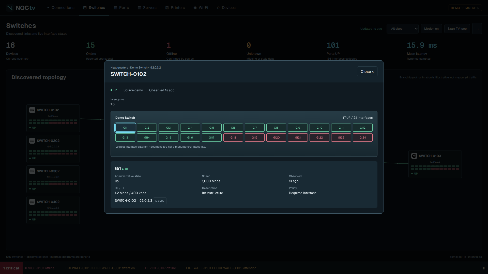

# NOCtv

**Your network, ready for the big screen.**

A self-hosted network operations dashboard with site connections, switch topology,
interactive interfaces and a TV rotation mode. Bring telemetry from LibreNMS,
Zabbix or supported firewall APIs; configure your own sites and equipment.

[Português](README.pt-BR.md) · [Setup](docs/setup.md) · [Integrations](docs/integrations.md) · [Create a connector](docs/connector-contract.md)


> **0.1 community preview.** Screenshots and the default installation use synthetic
> data. This release is fixture-tested, not certified against every vendor or
> firmware. See the integration matrix for actual coverage.

## Try it

With Docker Engine and Compose **2.24 or newer**:

```sh
git clone https://github.com/WeslleyDorta/NOCtv.git
cd NOCtv
docker compose up --build -d
```

Open **http://localhost:8080**. The demo makes no calls to network devices, APIs,
analytics or remote asset services. Stop it with `docker compose down`.

Or preview with Python **3.12+**, without installing any runtime dependencies:

```sh
python3 -m noctv serve
```

The Python preview server is for local evaluation. Docker uses Gunicorn. See
[deployment](docs/setup.md) before exposing a live installation to other users.

## Install with your coding agent

Open this repository in your agent and ask:

> Read AGENTS.md and docs/agent-install.md. Help me install NOCtv and connect my
> LibreNMS or Zabbix. Inspect the environment, preserve existing configuration,
> guide me to enter credentials locally, and verify actual telemetry.

The [installation guide](docs/agent-install.md) covers demo/live setup,
configuration, troubleshooting and recovery. `AGENTS.md` is the shared entry
point; `CLAUDE.md` imports it for Claude Code. With other tools, explicitly ask
the agent to read the files if they are not loaded automatically. The agent needs
access to the installation machine; NOCtv itself requires no AI service or key.

## What is included

- Connections, switches, ports, servers, printers, Wi-Fi and device views.
- Configurable sites with schematic, country or world maps; connections come from data.
  [240 country/territory entries](docs/maps.md) are bundled; no map API key is needed.
- Click a switch, select an interface, inspect its state and discovered neighbor.
- Per-source freshness, unknown states and required-interface alert policies.
- Top navigation, automatic TV rotation, longer connections dwell, reduced motion
  and a bottom alert ticker. Dialogs pause the TV loop.
- Shared server-side polling: adding viewers does not add upstream API requests.
- Manufacturer recognition for 25 brands, with 13 bundled, attributed logos.
- Site, category, device-name, URL, root-switch and monitoring interval overrides.



## Integrations at a glance

| Source | Included in this release |
| --- | --- |
| LibreNMS API v0 | Devices, availability, latency/uptime, interfaces, rates and LLDP/CDP links |
| Zabbix 7.0 API | Hosts, ICMP status, selected metrics and explicitly mapped interfaces |
| Prometheus API v1 | Explicit probe/status selectors and mapped gauge metrics; supports metrics already scraped from Uptime Kuma |
| NetBox 4.5+ | Device/site inventory with v2 tokens; no inferred operational availability |
| Forcepoint SMC 7.2 | Firewall/interface state, reported services and managed VPN metrics |
| FortiGate / PAN-OS | Device inventory and direct management API reachability |
| Check Point / Sophos Central | Managed firewall inventory; management connection status where explicitly supplied |

Monitoring coverage comes from the upstream system and its templates, permissions
and polling. A logo is **not** a compatibility certification. Inventory-only
adapters do not claim VPN or dataplane health. See [the full matrix](docs/integrations.md).

## Adapt it to your environment

1. Copy `.env.example` to `.env` and `config/live.example.json` to `config/local.json`.
2. Define your sites and select only the connectors you need.
3. Store credentials in environment variables; reference their names in JSON.
4. Map devices to sites/categories. Devices added upstream appear on a successful
   poll; NOCtv does not register or scan equipment itself.
5. Set `NOCTV_CONFIG_FILE=./config/local.json`, configure viewer authentication,
   validate with `python3 -m noctv check --config config/local.json`, then restart.

Detailed examples: [LibreNMS and Forcepoint](docs/setup.md), [Zabbix](docs/zabbix.md),
[firewall APIs](docs/firewalls.md), [Prometheus](docs/prometheus.md),
[NetBox](docs/netbox.md), [brand recognition](docs/brands.md).
Read the [integration research](docs/integration-research.md) for scope and trade-offs.

## Contribute

Start with [CONTRIBUTING.md](CONTRIBUTING.md). A connector returns the documented
[device/link contract](docs/connector-contract.md); the interface does not depend
on a particular vendor. Include synthetic fixtures and describe what the source
cannot establish. Issues about a device should identify firmware/API versions
without sharing addresses, credentials or private inventory.

```sh
python3 -m unittest discover -s tests -v
npm ci
npx playwright install chromium
npm test
```

Python is the application runtime; Node is used only for browser checks. No
frontend bundler, CDN, paid API or telemetry account is required.

## Current boundaries

- Current state in memory, one collector process; no historical database, HA or
  proven device-count limit. Scale must be measured against your sources.
- Generic interface diagrams, not manufacturer faceplates or a physical cabling
  guarantee. Discovered neighbors are shown only when the source reports them.
- TV views prioritize incidents and show coverage counts when inventory exceeds
  display capacity. They do not pretend every device fits on one screen.
- No automatic cross-source identity merge. Avoid collecting the same appliance
  twice unless separate cards are intentional.
- The interface is currently in English; Portuguese documentation is included.

Created by **[Weslley Dorta](https://github.com/WeslleyDorta)**.
Code is [MIT licensed](LICENSE). Fonts and brand icons retain their own licenses;
see [THIRD_PARTY_NOTICES.md](THIRD_PARTY_NOTICES.md). No vendor endorsement is implied.
