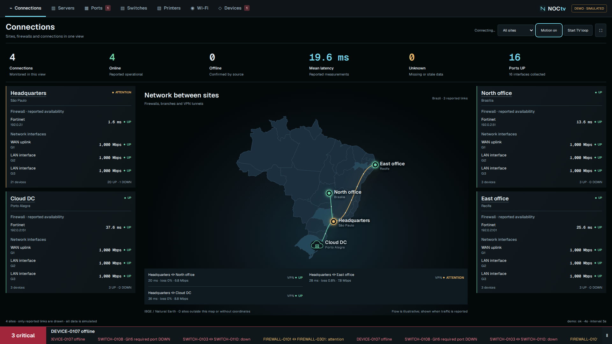
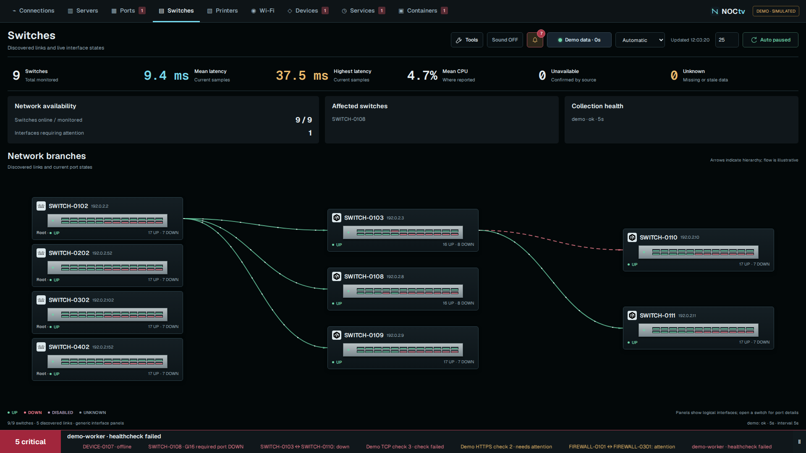

# NOCtv

**Sua rede em uma TV: conexões, topologia e incidentes sempre à vista.**

Painel de monitoramento de rede para TVs e operações de NOC. Reúne dados do
LibreNMS, Zabbix, Prometheus, NetBox e APIs de firewalls em telas de conexões, switches, portas,
servidores, impressoras, Wi-Fi, dispositivos, Serviços e Containers.

[Executar demonstração](#executar-a-demonstração) · [Conhecer as telas](docs/tour.md) · [Integrações](docs/integrations.md) · [English](README.md)



## Executar a demonstração

```sh
git clone https://github.com/WeslleyDorta/NOCtv.git
cd NOCtv
docker compose up --build -d
```

Acesse **http://localhost:8080**. Requer Docker e Compose 2.24 ou superior.
A demonstração funciona sem credenciais e sem consultar equipamentos reais.
Como alternativa local, use Python 3.12+: `python3 -m noctv serve`.

## Feito para acompanhar a operação

- Mapa de unidades e ramificações de switches, com portas interativas.
- Incidentes primeiro e alertas críticos na barra inferior.
- Rodízio automático e escolha das telas usadas por cada TV.
- Coletas antigas aparecem como desconhecidas, preservando a confiança no painel.



Veja a [galeria das nove telas](docs/tour.md). Você pode começar apenas com a
demonstração e depois conectar as fontes que já utiliza.

## Instalar com um agente de IA

Abra a pasta do projeto no seu agente e envie:

> Leia AGENTS.md e docs/agent-install.md. Ajude-me a instalar o NOCtv e conectar
> meu LibreNMS ou Zabbix. Verifique o ambiente, preserve configurações existentes,
> me oriente a preencher credenciais localmente e valide os dados recebidos.

O [roteiro de instalação](docs/agent-install.md) orienta a escolha da fonte,
configuração, diagnóstico e recuperação. `AGENTS.md` concentra as instruções;
`CLAUDE.md` importa esse mesmo arquivo para o Claude Code. Se o agente não carregar
os arquivos automaticamente, peça a leitura explicitamente. Ele deve responder
no seu idioma e precisa de acesso à máquina de instalação para executar comandos.
O NOCtv funciona depois sem agente, assinatura ou chave de IA.

## Serviços, containers e telas opcionais

Em **Tools → Visible screens**, escolha as telas que aparecem no menu e no
rodízio da TV. A escolha fica salva nesse navegador. Telas ocultas continuam
coletando dados e seus alertas críticos permanecem na barra. O arquivo de
configuração também define as telas disponíveis e sua ordem em `display.views`.

A tela **Services** reúne checks HTTP/HTTPS, TCP, DNS e ping; HTTPS mostra validade
do certificado. **Containers** mostra estado de execução, healthcheck, reinícios
e métricas opcionais de CPU/memória via API Docker HTTPS com acesso de leitura.
Veja [exemplos e limites](docs/services.md). Isso não implementa todas as funções
do Uptime Kuma; também é possível aproveitar os dados dele via Prometheus.

Kali não é necessário: a imagem Docker inclui ping, traceroute, DNS e Nmap.
Os [diagnósticos](docs/diagnostics.md) são opcionais, exigem redes autorizadas
na configuração e ficam desligados no modo real por padrão. Na demonstração,
todos os resultados são simulados.

## Adaptar

O [mapa pode ser esquemático, de um país ou mundial](docs/maps.md). São 240
entradas de países e territórios incluídas no projeto, sem chave de API de mapas.
No modo geográfico, configure o país e a latitude/longitude de cada unidade.

1. Copie `.env.example` para `.env`.
2. Copie `config/live.example.json` para `config/local.json`.
3. Configure unidades, posições no mapa e fontes de dados.
4. Coloque credenciais somente no ambiente; o JSON referencia nomes de variáveis.
5. Defina `NOCTV_CONFIG_FILE=./config/local.json`, `NOCTV_USER` e uma senha exclusiva
   com pelo menos 16 caracteres em `NOCTV_PASSWORD`.
6. Valide: `python3 -m noctv check --config config/local.json`.
7. Reinicie: `docker compose up -d --force-recreate`.

A publicação inicial é uma **prévia comunitária 0.1**. Os conectores têm testes com
respostas simuladas; a compatibilidade com cada firmware precisa ser validada no
seu ambiente. A interface está em inglês nesta versão.

LibreNMS e Zabbix permitem aproveitar o monitoramento que você já possui, inclusive
para equipamentos de diferentes fabricantes. Métricas dependem dos dados da
fonte. Zabbix usa mapeamentos explícitos para portas e métricas fora dos padrões
documentados. As APIs diretas de FortiGate/PAN-OS/Check Point/Sophos têm escopo de
inventário e gerenciamento; isso não comprova o estado das VPNs ou do tráfego.

O diagrama de portas é genérico. Os nomes dos vizinhos aparecem quando há evidência
de descoberta; nomes de interfaces não são tratados como prova da conexão.
Portas DOWN só geram alerta crítico quando marcadas como obrigatórias.

Prometheus amplia a integração com sondas e exporters, incluindo dados do Uptime
Kuma quando ele já é coletado pelo Prometheus. NetBox fornece inventário; o estado
operacional fica desconhecido sem uma fonte de monitoramento. Consulte os
[conectores e seus limites](docs/integrations.md).

São reconhecidas 25 marcas, com 13 logos redistribuíveis incluídas. Nos demais
casos, o sistema usa um ícone genérico. Identificação não equivale a certificação
de compatibilidade.

O modo real exige autenticação. Para acesso remoto, use HTTPS e controle de acesso;
o Compose publica apenas em localhost por padrão. Não publique o inventário da
sua organização em uma demonstração aberta.

## Participar

Teste no seu laboratório, relate a versão da ferramenta e os campos que funcionaram,
ou sugira uma integração com a documentação oficial da API. Também são bem-vindas
melhorias de instalação, traduções e exemplos fictícios.

[Relatar problema ou sugerir integração](https://github.com/WeslleyDorta/NOCtv/issues/new/choose).
Pode escrever em português ou inglês. Remova nomes, endereços, credenciais e alertas
reais antes de compartilhar capturas ou respostas de API.

Criado por **[Weslley Dorta](https://github.com/WeslleyDorta)**. Código sob licença
[MIT](LICENSE); fontes e marcas têm licenças próprias.
