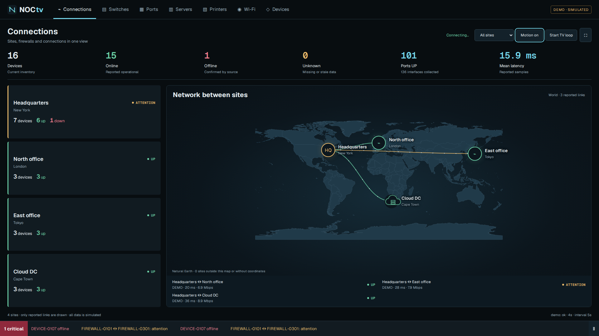

# Country and world maps

Configure the top-level `map` setting:

| Mode | Placement | Use |
| --- | --- | --- |
| `schematic` (default) | Site `x`/`y`, percentages 10–90 | Logical layouts |
| `country` | Site latitude/longitude and country code | One country's outline |
| `world` | Site latitude/longitude and country code | Multi-country networks |

Maps use bundled outlines, with no map API key, external tiles or geocoder.
Existing configurations retain their schematic layout. Map choice does not
change telemetry collection, source permissions or VPN state.




## Configure

For Brazil, add this alongside `sites`, `connectors` and `display`:

```json
"map": {"mode": "country", "country": "BR"}
```

Other examples include `PT`, `US`, `DE`, `JP`, `ZA` and `AU`.
For a multi-country network, use `"map": {"mode": "world"}`.
Geographic sites use explicit coordinates:

```json
{
  "id": "office",
  "name": "Example office",
  "city": "Lisbon",
  "kind": "headquarters",
  "country": "PT",
  "latitude": 38.72,
  "longitude": -9.14
}
```

Coordinates are decimal degrees (negative south/west), supplied together.
`x`/`y` are unnecessary in geographic mode. Locations are never guessed from
IPs or names. Sites without coordinates remain in inventory/cards but are not
plotted. Country mode plots only that country's sites inside its extent.
The caption counts sites outside the map or without coordinates. Links need two
visible endpoints and connector evidence; geography never creates connections.
Zabbix sites can be plotted, but its adapter does not report topology.

Complete synthetic examples: [country](../config/map-country.example.json) and
[world](../config/map-world.example.json). Preview on an unused port:

```sh
python3 -m noctv serve --config config/map-world.example.json --port 8081
```

For live use, merge map/site settings into the existing configuration. Do not
replace live configuration with a demo example. Site dialogs, status colors and
illustrative flow animations are reused from the schematic map.

## Extent and limits

Country mode uses an equirectangular projection with longitude scaled by the
cosine of its middle latitude; world mode uses plate carrée. Outlines and sites
share the same transform, retaining aspect ratio on resize. Country extents
handle the antimeridian. Overseas territories may make an extent large; focus
the view with optional `[west, south, east, north]` bounds, for example:

```json
"map": {"mode": "country", "country": "US", "bounds": [-125, 24, -66, 50]}
```

This focuses on the contiguous US, excluding Alaska/Hawaii. Explicit bounds
must have west < east and south < north; they cannot cross the antimeridian.
Sites outside the extent are not plotted. This is not a street map.

There is no zoom/pan, state/province layer, automatic label collision avoidance
or geocoding. Nearby site labels may overlap; use a narrower scope or schematic
layout for local networks. World links use curved paths, not geodesic routes or
dateline wrapping. Boundaries are generalized monitoring context.

## Source and reproduction

Made with [Natural Earth](https://www.naturalearthdata.com/):
[50m Admin 0 Countries](https://www.naturalearthdata.com/downloads/50m-cultural-vectors/50m-admin-0-countries-2/)
from the [v5.1.2 repository release](https://github.com/nvkelso/natural-earth-vector/blob/v5.1.2/geojson/ne_50m_admin_0_countries.geojson),
under its [public-domain terms](https://www.naturalearthdata.com/about/terms-of-use/).
The source uses de facto boundaries; NOCtv inherits its cartography.

242 source features become 240 entries after grouping shared country codes.
Coordinates are rounded to three decimals; properties other than names/codes
are removed. Most codes come from `ISO_A2_EH`, including the source's `XK`.
Entries without that field use `ADM0_A3`: `SOL`, `CYN`, `KAS`. These are dataset
identifiers, not a claim that every entry is a sovereign country or ISO code.

List bundled codes:

```sh
python3 -c "from noctv.geography import countries; print('\n'.join(k + ' ' + v['name'] for k,v in sorted(countries().items())))"
```

The upstream SHA-256 is
`3e458fc036ad0a66411f2c1e6cac49c5d7bfb81cb1123bc513b22511a2b7fdeb`.
Maintainers can reproduce `noctv/data/countries.json` with
`python3 tools/update_maps.py`. It downloads the pinned source and verifies the
hash before writing. Startup never runs this maintenance download.
