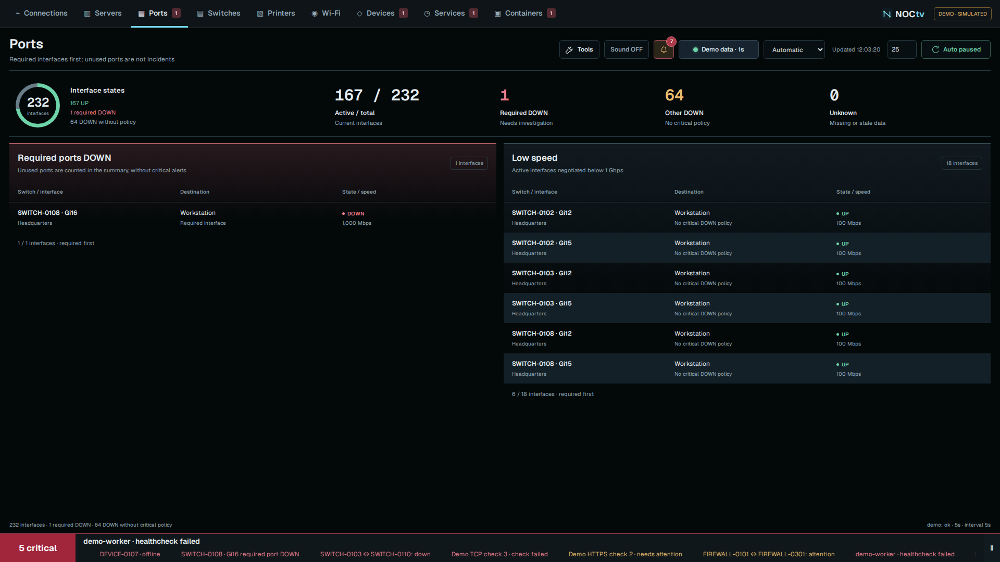
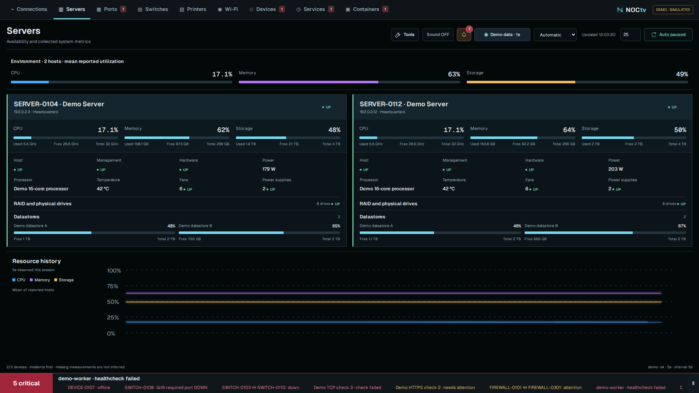
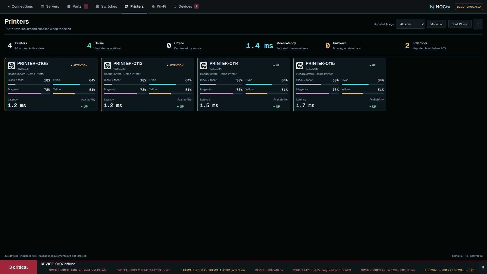
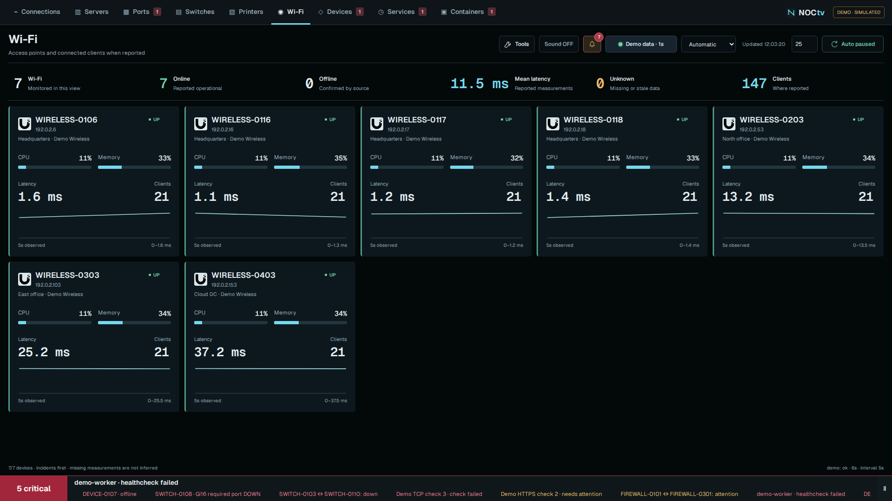
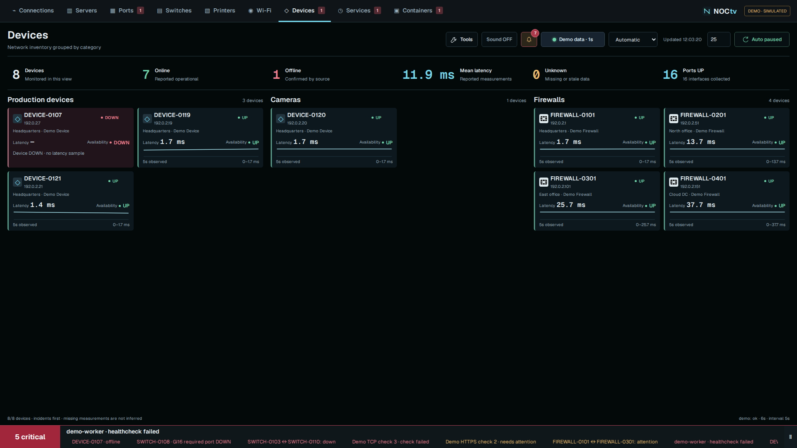
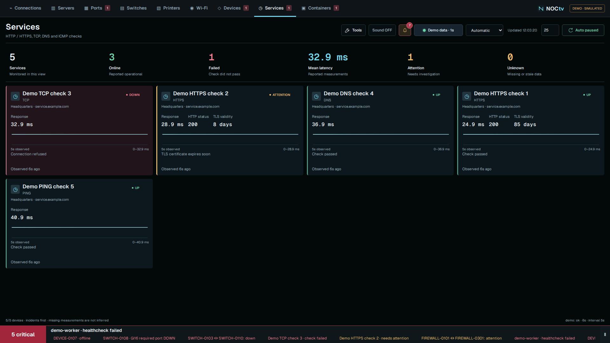
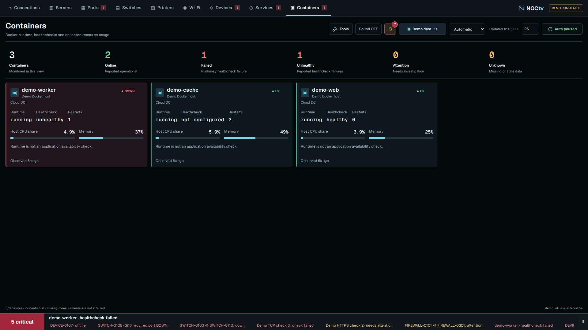
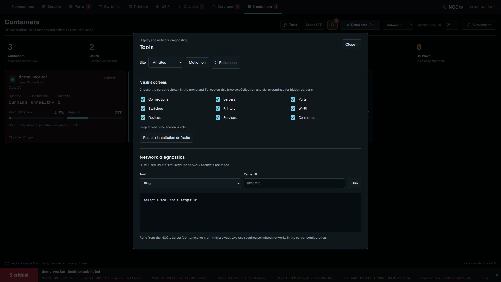

# Tour NOCtv

[Run the demo](../README.md#try-it) · [Configure sources](setup.md) · [Português](../README.pt-BR.md)

These are captures of the community edition using fictional devices and data.
Click an image for the full-size view. Measurements depend on what your source
actually reports; empty fields stay unavailable.

## Connections

See units on a country/world map, reported VPN links, firewalls and interfaces.
Select a site to inspect its inventory and reported connections. Map motion is
illustrative, not packet capture.

## Switches and interfaces

Follow discovered branches, check miniature interface states and open a switch
to inspect a port. Neighbors appear only when the source reports discovery evidence.
Interface drawings are generic, not manufacturer faceplates.

## Ports

Required interfaces DOWN and active low-speed links occupy separate panels.
Unused DOWN ports do not automatically become critical incidents.

## Servers

Availability, CPU, memory, storage and optional hardware readings. The demo shows
these fields; actual coverage depends on the connector. Charts accumulate samples
from the current browser session.

## Printers, Wi-Fi and devices

Supplies and client counts appear when collected. Other devices are grouped by
category so cameras, routers and production equipment can be read separately.

| Printers | Wi-Fi |
| --- | --- |
|  |  |

## Services and Containers

Check HTTP/HTTPS, TCP, DNS or ICMP destinations. HTTPS can report certificate
expiry. Docker monitoring distinguishes container runtime from application
healthchecks, with optional resource readings.

| Services | Containers |
| --- | --- |
|  |  |

## Set up the TV once

Choose visible screens, display profile, sound and rotation duration. Connections
can stay on screen longer. Hidden screens leave the menu and TV loop; collection
and global alerts remain active. Open dialogs pause rotation.

Ready to connect your environment? Start with [setup](setup.md) and the
[integration matrix](integrations.md). Native checks and Docker have their own
[configuration examples](services.md).
