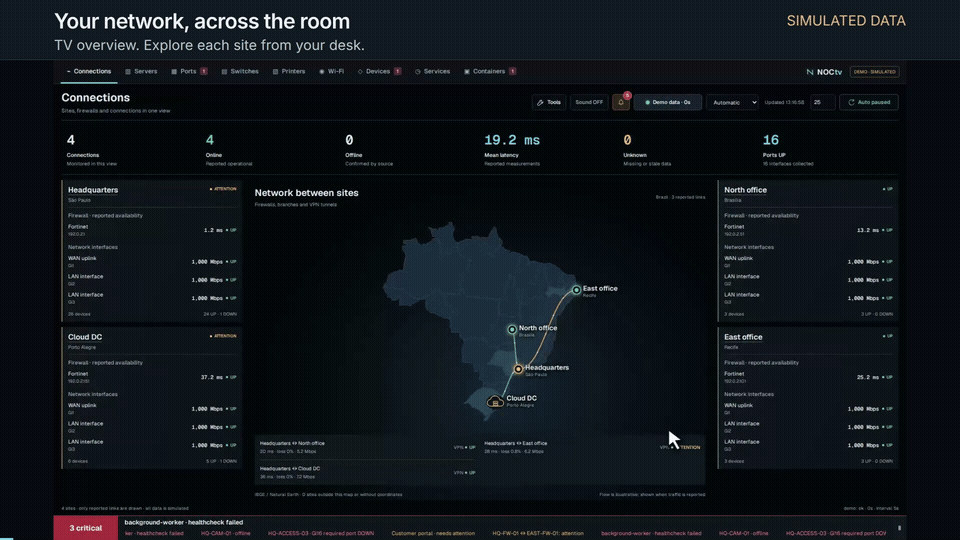

# NOCtv in motion / NOCtv em movimento

**75 seconds · 1080p · English and Portuguese explanations · Synthetic data**

[Watch / download in English](https://github.com/WeslleyDorta/NOCtv/raw/refs/heads/main/docs/video/noctv-tour-en.mp4) ·
[Assistir / baixar em português](https://github.com/WeslleyDorta/NOCtv/raw/refs/heads/main/docs/video/noctv-tour-pt-BR.mp4)

**[Play the full video with chapters / Assistir ao vídeo completo](https://weslleydorta.github.io/NOCtv/video/)**

The GIF above is a 6-second preview. O GIF acima é uma prévia de 6 segundos.

NOCtv is designed for monitoring on a TV from across the room and for opening
sites, devices and ports from a nearby computer. The video records the actual
community interface: animated map flows, switch paths, the scrolling notification
bar, a simulated port outage and recovery, service checks, Docker health and
selection of visible screens. All nine screens appear.

O NOCtv ajuda a acompanhar a rede de longe em uma TV e a investigar detalhes de
perto no computador. O vídeo mostra a interface real do projeto comunitário em
movimento, com incidentes e recuperações simulados. As explicações estão nos dois
idiomas; a interface gravada continua em inglês.

## Chapters / Capítulos

| Time | English | Português |
| --- | --- | --- |
| 00:00 | Connections and animated map | Conexões e mapa animado |
| 00:08 | Site and firewall details | Unidade e firewall |
| 00:14 | Switch topology | Topologia dos switches |
| 00:20 | Port outage and recovery | Falha e recuperação de uma porta |
| 00:30 | Actionable ports | Portas que exigem ação |
| 00:34 | Servers | Servidores |
| 00:38 | Printers | Impressoras |
| 00:42 | Wi-Fi | Wi-Fi |
| 00:46 | Device categories | Categorias de dispositivos |
| 00:50 | Service checks and recovery | Checks e recuperação de serviço |
| 00:56 | Docker healthcheck | Healthcheck do Docker |
| 01:01 | Visible screens | Telas visíveis |
| 01:07 | Demo-to-live setup | Da demonstração ao ambiente real |

Watch online using the player linked above: 75 seconds, playback controls,
clickable chapters and language selection. You can also clone/download the
repository and open `docs/video/index.html` locally, without a separate service.

The devices and addresses are fictitious. Incident timing is scripted for the
tour, not a promise of detection latency; real update times depend on each source
and its configured collection interval. These recorded clicks do not operate
live equipment. [Recreate/edit with HyperFrames](../../videos/noctv-tour/README.md).
